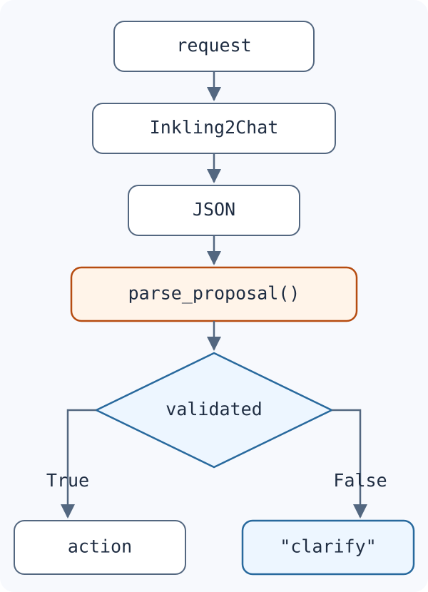
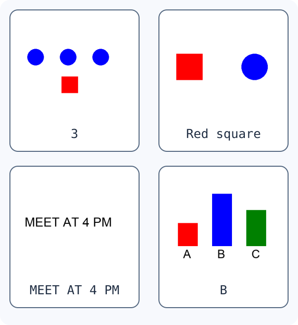

# Inkling 2 Mini: local action selection

Use `Inkling2Chat` to classify a text or image request into a small, explicit set
of actions. The example runs through the local Swift CLI, parses the final reply,
and returns an action proposal. It does not execute the action.



The example's four actions are `answer`, `summarize`, `describe_image`, and
`clarify`. Unknown actions, extra JSON fields, duplicate keys, malformed output,
missing image input, timeouts, and inference failures fall back to `clarify`.
The parser rejects responses larger than 4,096 bytes. The native CLI limits the
request to its 8,192-token default context budget and 512 generated tokens.

```bash
python3 scripts/examples/inkling2_decision.py \
  'Summarize this note: The train is delayed by ten minutes. The platform has changed to number four.' \
  --model-dir /path/to/Inkling-2-Mini-MLX-5bit \
  --speech .build/debug/speech
# {"action": "summarize", "validated": true, "fallback_reason": null}

python3 scripts/examples/inkling2_decision.py \
  'Describe the shapes in the attached image.' \
  --model-dir /path/to/Inkling-2-Mini-MLX-5bit \
  --image Tests/Qwen3ChatTests/Fixtures/Inkling2/quality-spatial.png
```

Build the CLI and MLX metallib as described in the [inference guide](inkling2-mini.md).
The example downloads no weights and makes no hosted inference calls. Supply a
local model directory. For a release build, pass `--speech .build/release/speech`.
Run model-loading jobs sequentially.

## Interpreting the proposal

`validated` means that the reply satisfies the example's schema, allowed actions,
and image-input check. It does not establish that the model chose the correct
action, express calibrated confidence, or authorize an operation. A caller still
checks task preconditions and its own permissions before using a proposal.

The backend currently implements free text generation. It does not implement
constrained JSON decoding or native tool-call parsing. Prompting for JSON and
validating it afterwards gives the caller a deterministic fallback when the
model returns another format. Even effort zero can consume hidden reasoning;
the example reserves 512 generated tokens and a 120-second timeout.

Inkling's text/image reasoning can help when an action depends on a passage,
conversation, or image. The INT4/INT5 tensors alone occupy 16.1/19.2 GB, before
caches and intermediate arrays. A small classifier or language model can be a
better fit for a short list of text-only intents. Measure the actual routing
task and latency before choosing a model for interactive use.

For scoring a supplied list of text answers, see [Clef](../models/clef.md).
For label-based text classification, see [GLiNER](../models/gliner.md).
Those APIs address different decision tasks from this example's prompted JSON
generation. This example starts a CLI process per request; the native Swift API
can reuse one loaded model for serialized requests.

## Tests and reproduction

CPU tests exercise the parser, the allow list, failure handling and literal CLI
arguments, without loading a model:

```bash
python3 -m unittest discover -s scripts/tests -p 'test_inkling2_decision.py' -v
```

Eight opt-in real-model cases cover a question, a question about supplied text,
summarization, an image, a missing image, an ambiguous request, an unsupported
action and a request to override the output policy. The fixture contains expected
actions, not generated run data. The runner records raw results outside the repo:

All eight passed on the published INT5 bundle on 2026-11-22, using an Apple M5
Pro with 48 GB unified memory. This action-selection run did not test INT4.

```bash
python3 scripts/tests/e2e_inkling_decisions.py \
  --model-dir /path/to/Inkling-2-Mini-MLX-5bit \
  --output /tmp/inkling-decisions/results.json
```

These fixed cases do not establish general routing accuracy or resistance to
prompt injection. The example returns a proposal for the caller to assess.

## Image acceptance examples



Both published variants returned these four replies in their separate 25-case
acceptance runs. See the [INT4 report](../benchmarks/inkling2-mini.md#int4-acceptance) and
[INT5 report](../benchmarks/inkling2-mini.md#int5-acceptance). The pictures demonstrate
selected checks; no natural-image benchmark was run.
