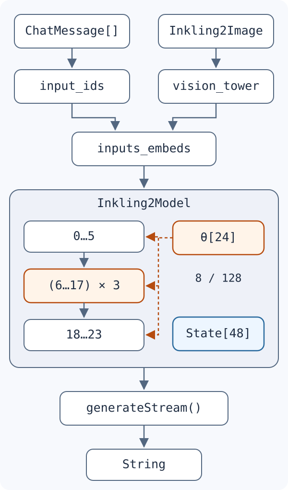
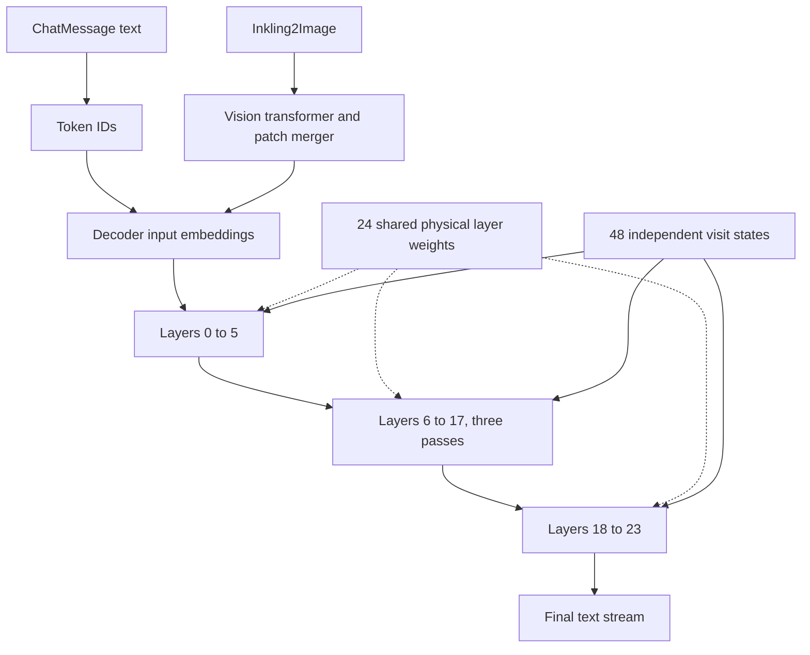

# Inkling 2 Mini

The `Qwen3Chat` library includes a native MLX Swift backend and weight exporter for
[Thinking Machines' Inkling 2 Mini](https://huggingface.co/thinkingmachines/Inkling-2-Mini).
`Inkling2Chat` provides streaming text generation and still-image input.
It conforms to `Qwen35ChatBackend` for use with `Qwen35PipelineLLM`.
The `speech inkling` command loads a local exported checkpoint.

The source is pinned to commit `ed40e7da625f594fc9c4990f5f66be24873c22d7`.
Inkling 2 Mini is a multimodal mixture-of-experts transformer with 26.4 billion
total parameters and 3.4 billion active parameters before accounting for loops.
Its 24 stored decoder layers include 12 middle layers that execute three times,
giving 48 layer applications per token. Each token selects eight of 128 experts.
The export preserves the loop configuration and shared weights, rather than
duplicating the repeated layers.

The state count covers all 48 visits, including the prelude and final layers.
Each visit has attention state and four convolution histories. Each decoder
layer selects eight of 128 experts. The diagram omits individual attention,
residual and message-controller operations.

`Inkling2Model.State` stores a separate attention cache and four convolution
histories for every layer visit. Reusing a physical layer's cache across loop
passes would mix incompatible histories. Local attention retains a chronological
sliding tail; global attention retains its full history. Relative-position
logits depend on backward distance, without text RoPE. Query-dependent attention
sinks are represented by one zero key/value and a learned sink logit.

Attention residuals combine completed blocks and the current partial block.
Each new core pass starts again from the prelude and receives normalized messages
from the previous core pass through low-rank forget/gain controllers. Sparse
experts use sigmoid routing, correction bias for selection, and softcapped SwiGLU.
Routing, attention residuals, convolutions, and message-controller arithmetic
preserve the reference's FP32 accumulation boundaries.

The upstream checkpoint stores expert weights in two different formats:

| Layers | Source weights | Scales | Export |
| --- | --- | --- | --- |
| 0–19 | NVFP4 E2M1, two values per byte | E4M3FN per 16 weights, with per-expert outer scale | Affine MLX INT4, INT5, or INT8 |
| 20–23 | MXFP8 E4M3FN | UE8M0 per 32 weights | Affine MLX INT4, INT5, or INT8 |
| Attention and vocabulary matrices | BF16 | — | Affine MLX INT8 |
| Vision, routers, norms, relative-position parameters, loop controllers | Source BF16 or FP32 | — | Source precision |

NVFP4 outer scales are `weight_amax / weight_outer_scale_denominator`.
The fused `w13_weight` interleaves gate and up rows; splitting it into contiguous
halves would corrupt the expert functions. The exporter separates alternating
rows into the MLX `gate_proj` and `up_proj` tensors. It also reorders static
Conv1d weights and combines cross-pass queries in attention/key/value/MLP order.

The output uses the MLX-VLM Inkling 2 parameter layout:
`language_model.model`, `language_model.lm_head`, and `vision_tower`.
Quantized matrices have `weight`, `scales`, and `biases` tensors. Expert tensors
retain an outer expert dimension. Per-module INT8 overrides accompany the
default expert precision in `config.json`.

The still-image encoder uses 20-pixel native patches, a 23-layer vision
transformer, learned position-grid interpolation, spatial RoPE, and a 2×2 patch
merger projecting into the decoder's hidden space. RGB images are padded to
40-pixel boundaries, with one language token per merged patch. The default
image budget is 1,024 tokens. Images replace placeholder embeddings before
the decoder's chunked prefill.

The export changes weight representation and does not reproduce the source
activation quantization. Requests use fresh cache state, 128-token prefill
chunks, and an 8,192-token prompt-plus-output budget by default. The context
budget can be configured up to the checkpoint limit; large contexts require
additional memory and are not implied by the on-disk weight size. Instances
serialize requests; cancellation releases the request's cache when generation
exits. The streaming interface suppresses reasoning and framing tokens.
Native tool-call parsing and DSpark speculative decoding are not implemented.
The source model's Apache 2.0 license is preserved in the bundle, together with
the original model card and configuration.

See [Swift and CLI inference](../inference/inkling2-mini.md) and
[export usage and verification](../inference/inkling2-mini-export.md).
The [local decision example](../inference/inkling2-mini-decisions.md) uses the same
runtime to propose validated actions.
